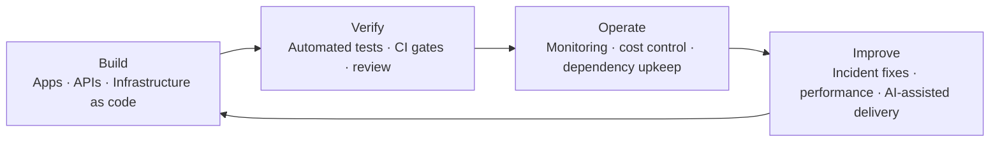

# TM-59

**Software & infrastructure engineering · Operations · Generative AI**  
ソフトウェアとインフラの設計・開発、運用保守、生成AIの活用。

I build, deploy and maintain applications and infrastructure, combining automated verification with AI-assisted development.
アプリケーションと基盤を構築・配信・保守し、自動検証と生成AIを開発工程に組み込んでいます。

## Engineering capabilities / 開発・運用領域

<picture>
  <source media="(prefers-color-scheme: dark)" srcset="https://github.com/TM-59/TM-59/releases/download/showcase/stack-distribution-dark.png">
  <source media="(prefers-color-scheme: light)" srcset="https://github.com/TM-59/TM-59/releases/download/showcase/stack-distribution-light.png">
  
</picture>

| Area / 領域 | Work delivered / 実装・運用内容 |
|---|---|
| **Cloud infrastructure** インフラ開発 | Provisioning, state import and drift reconciliation Terraform による構築、既存資源の取り込み、宣言と実環境の整合 Terraform / Azure / Cloudflare |
| **Reliability & operations** 運用保守 | Monitoring, incident fixes, dependency and cost controls 監視、障害の原因調査と修正、依存更新、費用管理の自動化 Linux / Python / GitHub Actions |
| **Generative AI engineering** 生成AI活用・開発 | AI-assisted delivery and locally grounded LLM workflows 生成AIを使う実装・レビューと、検索根拠を伴うローカルLLM処理 Claude Code / Codex / Ollama / RAG |
| **Machine learning & MLOps** 機械学習・モデル運用 | Training, registry, HTTP inference and drift detection 学習・評価、モデル登録、HTTP推論、入力分布の変化の検知 PyTorch / scikit-learn / MLflow / Databricks |
| **Application & API engineering** アプリケーション・API開発 | Web applications, APIs, authentication and persistence Webアプリ、API、認証、永続化を含む実装と検証 TypeScript / React / Python / SQL |
| **Systems & performance** システム開発・性能改善 | Native and browser runtimes, profiling and regression checks ネイティブ・ブラウザ実行環境、性能計測、回帰検証 C++ / C# / WebAssembly / Unity |

## Selected engineering work / 主な取り組み

- **Infrastructure & operations:** managed Azure and Cloudflare resources with Terraform; reconciled imported state; removed unused paid infrastructure; automated service checks and dependency maintenance.
   Azure・Cloudflareの基盤管理、既存資源とstateの整合、不要な課金資源の撤去、稼働確認と依存更新の自動化。
- **Generative AI:** used Claude Code and Codex for implementation, review and test automation; built local LLM retrieval and OCR workflows with source checks and data isolation.
   生成AIによる実装・レビュー・検証の支援と、根拠照合・データ隔離を組み込んだローカルLLM・検索・OCR処理。
- **ML lifecycle:** built reproducible CPU training, MLflow tracking and model registration, HTTP inference and drift checks; verified training and monitoring jobs on Databricks Free Edition.
   CPU学習から実験管理・モデル登録・HTTP推論・分布ずれ検知まで実装し、Databricks Free Editionでも学習・監視ジョブを検証。
- **Performance & quality:** profiled runtime bottlenecks, improved rendering and loading, and used automated regression checks across browser and native applications.
   ブラウザ・ネイティブアプリの性能要因を計測し、描画・読み込みを改善。自動検証で回帰を確認。

## Projects in progress / 進行中のプロジェクト

Ongoing work follows one loop: build, verify, operate, improve. Details are kept at the category level.
進行中の取り組みは「作る・検証する・運用する・改善する」の循環で進めています。内容は種類の単位でのみ記載します。

- **Web products and games:** browser products released in small steps, each with automated regression checks.
   ブラウザ向けのサービス・ゲームを小さな単位で公開し、自動検証で回帰を防ぐ。
- **Platform and operations:** infrastructure as code, monitoring, dependency and cost upkeep.
   コードによる基盤管理、監視、依存更新と費用管理。
- **Local AI tooling:** retrieval, OCR and agent collaboration where results are checked by machines and adopted only after human review.
   検索・OCR・エージェント協業。機械検査と人の確認を経たものだけを採用。
- **ML operations:** training, model registry, inference and drift monitoring as one repeatable pipeline.
   学習・モデル登録・推論・分布ずれ監視を再現できる一連の流れとして運用。

## Physics simulators in C / C言語の物理シミュレータ

Open-source toys you operate in a terminal. Each one checks its numerical results against analytic solutions in unit tests; the charts below come from the repositories.
端末で操作できる公開ソフトウェア。数値結果は解析解と単体テストで照合しています。下図は各リポジトリの出力です。

<table>
<tr>
<td width="50%" valign="top"> <strong><a href="https://github.com/TM-59/current-swimmer">current-swimmer</a></strong> · Fluid dynamics / 流体力学 Steer a swimmer through a Stable Fluids flow and watch its wake. 水中の生物を操作し、後流を観察。</td>
<td width="50%" valign="top"> <strong><a href="https://github.com/TM-59/lift-pilot">lift-pilot</a></strong> · Flight dynamics / 飛行力学 Fly a glider with stall; the phugoid period matches Lanchester's formula. 滑空機を操縦。フゴイド周期が理論式と一致。</td>
</tr>
<tr>
<td width="50%" valign="top"> <strong><a href="https://github.com/TM-59/gravity-well">gravity-well</a></strong> · Gravity and orbits / 重力・軌道 Pilot a spacecraft; the Hohmann transfer reproduces the textbook delta-v. 探査機を操作。ホーマン遷移が理論値どおり。</td>
<td width="50%" valign="top"> <strong><a href="https://github.com/TM-59/relativity-rider">relativity-rider</a></strong> · Special relativity / 特殊相対論 Ride a 1 g rocket to 4.2 ly: 3.53 yr on board, 5.82 yr on Earth. 1 g で 4.2 光年。船内 3.53 年、地球 5.82 年。</td>
</tr>
<tr>
<td width="50%" valign="top"> <strong><a href="https://github.com/TM-59/quantum-wave-hopper">quantum-wave-hopper</a></strong> · Quantum mechanics / 量子力学 Tune a barrier for a wave packet; tunnelling matches theory within 0.3%. 障壁を操作。トンネル透過率が理論と 0.3% 以内。</td>
<td width="50%" valign="top"> <strong><a href="https://github.com/TM-59/field-ripple">field-ripple</a></strong> · Field theory / 場の理論 Push a sine-Gordon kink; it contracts like a relativistic particle. 場のキンクを押す。ローレンツ収縮を確認。</td>
</tr>
</table>

## Live products / 公開中のサービス

<table><tr>
<td width="50%" valign="top"><strong><a href="https://math.cloud-tm.com/">Math Practice</a></strong> 数学演習  Interactive practice and guided learning 問題演習と基礎からの学習</td>
<td width="50%" valign="top"><strong><a href="https://soraniwa.cloud-tm.com/">Soraniwa</a></strong> 環境音ミキサー  Ambient audio for focused work 集中のための環境音ワークスペース</td>
</tr></table>

Updated 2026-10-17 07:27 JST

<!-- skills:start -->

## Skills / スキル

Agent Skills (`SKILL.md`) for the languages, technologies and certifications used across this account: defaults, verification steps and pitfalls from real work. Format and rules: [spec](docs/spec.md) · [architecture](docs/architecture.md).
各言語・技術要素・資格を使いこなすための SKILL.md。既定の進め方・検証・落とし穴をまとめています。

### Languages / 言語

[Bash](skills/languages/bash/SKILL.md) · [C](skills/languages/c/SKILL.md) · [C++](skills/languages/cpp/SKILL.md) · [C# on .NET](skills/languages/csharp/SKILL.md) · [Dart and Flutter](skills/languages/dart/SKILL.md) · [Elixir, Phoenix and OTP](skills/languages/elixir/SKILL.md) · [Go](skills/languages/go/SKILL.md) · [Java](skills/languages/java/SKILL.md) · [JavaScript](skills/languages/javascript/SKILL.md) · [Julia](skills/languages/julia/SKILL.md) · [Kotlin (JVM)](skills/languages/kotlin/SKILL.md) · [PHP with Laravel](skills/languages/php/SKILL.md) · [Python](skills/languages/python/SKILL.md) · [R](skills/languages/r/SKILL.md) · [Ruby on Rails](skills/languages/ruby/SKILL.md) · [Rust](skills/languages/rust/SKILL.md) · [Swift (packages and command-line tools)](skills/languages/swift/SKILL.md) · [TypeScript](skills/languages/typescript/SKILL.md) · [Visual Basic .NET](skills/languages/vbnet/SKILL.md) · [x86-64 assembly (Linux, no libc)](skills/languages/x86-64-assembly/SKILL.md)

### Technologies / 技術

[Azure Static Web Apps](skills/tech/azure-static-web-apps/SKILL.md) · [Canvas 2D games](skills/tech/canvas-2d/SKILL.md) · [Cloudflare Pages (+ Functions, D1)](skills/tech/cloudflare-pages/SKILL.md) · [Databricks](skills/tech/databricks/SKILL.md) · [Dependabot at scale](skills/tech/dependabot/SKILL.md) · [Docker](skills/tech/docker/SKILL.md) · [GitHub Actions on a budget](skills/tech/github-actions/SKILL.md) · [Kubernetes](skills/tech/kubernetes/SKILL.md) · [Local RAG (embeddings + SQLite + local LLM)](skills/tech/local-rag/SKILL.md) · [MLflow](skills/tech/mlflow/SKILL.md) · [Ollama (local LLMs)](skills/tech/ollama/SKILL.md) · [Playwright](skills/tech/playwright/SKILL.md) · [PyTorch (CPU-first)](skills/tech/pytorch/SKILL.md) · [Raylib-cs (C# desktop games)](skills/tech/raylib-cs/SKILL.md) · [raylib + Emscripten](skills/tech/raylib-emscripten/SKILL.md) · [React + Vite](skills/tech/react-vite/SKILL.md) · [Terraform](skills/tech/terraform/SKILL.md) · [Three.js](skills/tech/threejs/SKILL.md) · [Unity](skills/tech/unity/SKILL.md) · [Vitest](skills/tech/vitest/SKILL.md) · [WebAuthn passkeys](skills/tech/webauthn-passkeys/SKILL.md)

<!-- skills:end -->
