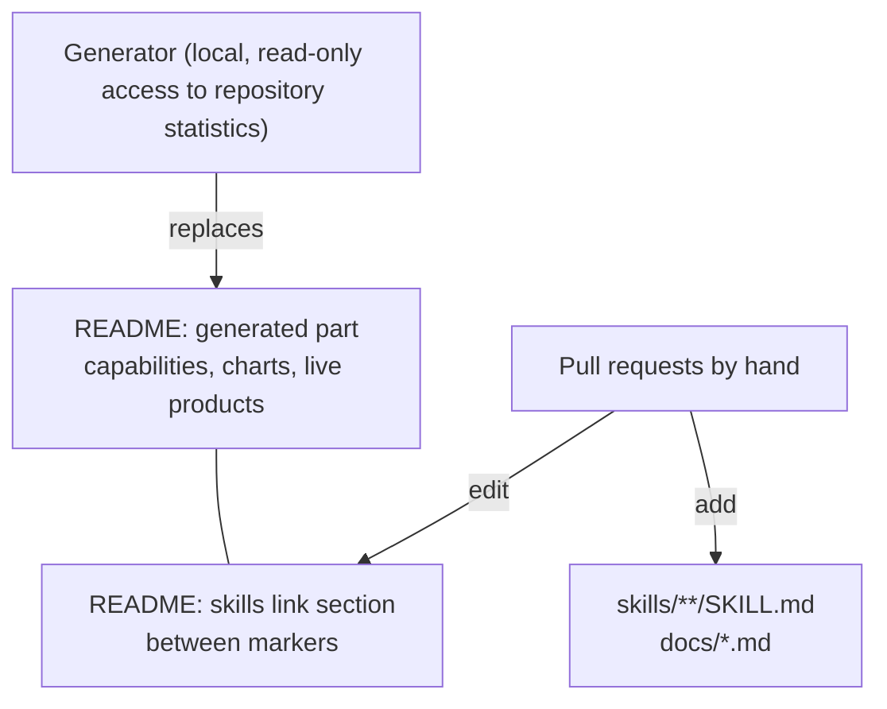

# Architecture of this profile repository

<sub>このプロフィールリポジトリの構成。README の自動生成部分と、手で管理する skill 集の関係を説明する。</sub>

## 1. Layout

```text
README.md                         profile page shown on github.com/TM-59
docs/
  spec.md                         rules for writing and changing skills
  architecture.md                 this file
skills/
  languages/<slug>/SKILL.md       one skill per programming language
  tech/<slug>/SKILL.md            one skill per framework, platform or tool
  certs/<slug>/SKILL.md           one skill per certification
```

Only Markdown lives in the repository. Charts and demo animations used by the README are attached to a GitHub Release of this repository and referenced by URL, so the git history stays small and text-only.

## 2. Two owners of the README



- **Generated part (top).** A local generator counts languages and frameworks across repositories and renders the upper part of the README. It publishes counts and technology names only.
- **Skills link section (bottom).** Everything between `<!-- skills:start -->` and `<!-- skills:end -->` is maintained through README-only pull requests. The generator copies this block unchanged when it refreshes the upper part.
- **Other files.** The generator never touches `skills/` or `docs/`.

## 3. How a change flows

1. Write one Markdown file on a short-lived branch.
2. Check the file, the commit message and the pull request description for private information (scanner plus reading the diff).
3. Open a pull request containing only that file.
4. Check the pull request diff and description again, confirm the diff is identical to what was reviewed locally, then squash-merge and delete the branch.
5. After a batch of skills is merged, open a README-only pull request that adds their links.

History is linear and ordinary: no force pushes and no rewritten commits.

## 4. How a skill is loaded

Skills use progressive disclosure:

| Stage | What is read | When |
|---|---|---|
| Discovery | `name` and `description` from the front matter | Always, for every installed skill |
| Activation | The `SKILL.md` body | When the task matches the description |
| Detail | Linked files, if any | Only when the body points to them |

That is why descriptions name concrete tasks and trigger words, and why bodies stay short and practical.

## 5. Guards

| Risk | Guard |
|---|---|
| Private names, hosts, paths, identifiers or credentials in public text | Local scanner on every file, commit message and pull request description, run before commit and before merge |
| Anything other than Markdown entering the repository | The generator refuses to publish when the tree contains files outside `README.md`, `docs/*.md` and `skills/<category>/<slug>/SKILL.md` |
| Generator overwriting hand-written content | The link section is kept by marker; the generator changes the README only through a pull request |
| Stale facts (versions, fees, exam rules) | Skills link to the official source instead of copying changeable details |
